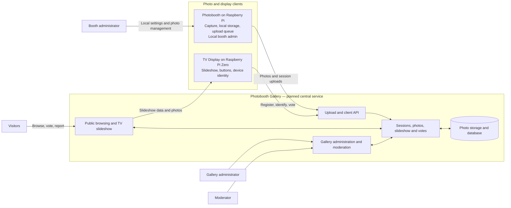

# Photobooth Gallery

Photobooth Gallery is the central service in this project. It is planned as an always-available place to collect and browse photos from one or more photobooths, run session slideshows, and manage community and moderation features. The gallery is designed to keep browsing available even when a photobooth is offline.

The system has three deployable components:

- **Gallery** (`gallery/`) is the planned hosted service. It will receive and serve photos, manage sessions and TV displays, collect votes and reports, and provide administration and moderation tools. Its design is documented in [`gallery/README.md`](gallery/README.md); implementation and deployment choices are still to be made.
- **Photobooth** (`photobooth/`) is the working camera-connected Raspberry Pi application. It captures photos and collages, stores them locally, and has a persistent upload queue for providing photos to the gallery. Its local kiosk and admin panel continue to work independently. See [`photobooth/README.md`](photobooth/README.md) for setup and operation.
- **TV Display** (`tv-display/`) is the planned Raspberry Pi Zero client. It will connect to the gallery to show an assigned session slideshow and send TV interactions such as votes. Its local Wi-Fi setup, GPIO controls, and kiosk browser are documented in [`tv-display/README.md`](tv-display/README.md); this component is also still at the design stage.

The [Photobooth Remote](remote/README.md) is a battery-powered, two-button Bluetooth keyboard for triggering captures at the booth. The remote directory contains the wiring guide and Arduino firmware.

## Information flow

The photobooth is the photo source: it captures images and uploads them when the gallery is available. The TV Display consumes gallery slideshow content and can send interaction data; it does not upload camera photos. Visitors use the gallery's browsing and voting experience, while moderators review reports there. Booth configuration and local photo management remain part of the photobooth's own admin interface. Gallery administration handles shared sessions, TV pairing and assignment, and moderation.

## Current status

The photobooth application is implemented and has been tested on Raspberry Pi 5 with Raspberry Pi OS Desktop. It is a local Flask web app with a Chromium kiosk, gPhoto2 camera control, Bluetooth button, GPIO flash, four-photo collages, and a persistent upload queue. The gallery and TV Display directories currently contain design plans, not running services. The planned upload, pairing, browsing, voting, and moderation flows depend on implementing and deploying the gallery and TV client.
