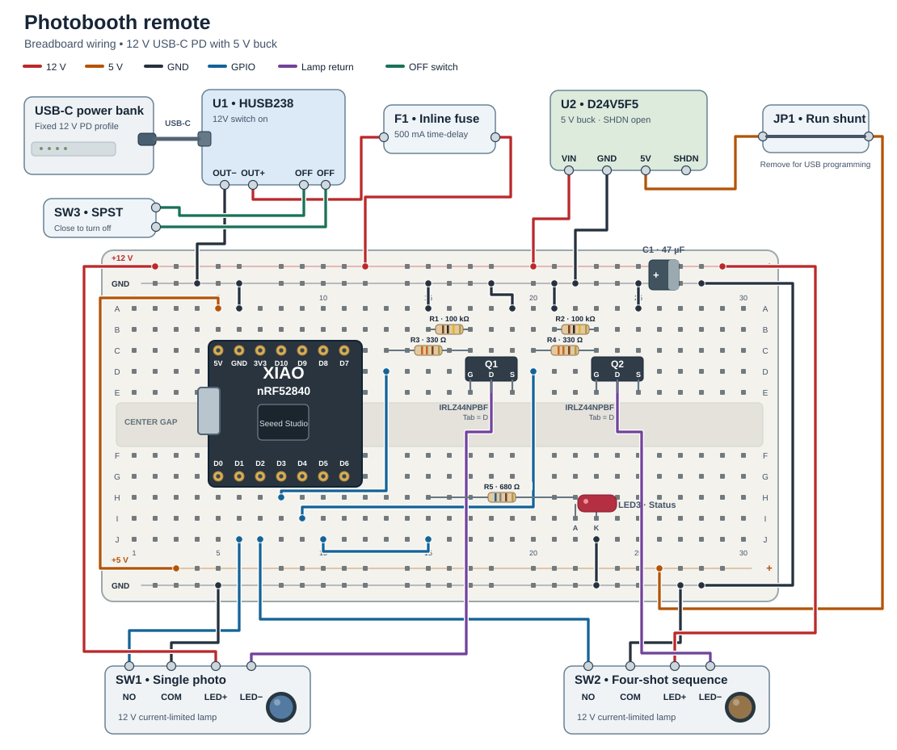

# Photobooth Remote

The remote pairs with the photobooth's Raspberry Pi as a Bluetooth Low Energy (BLE) HID keyboard. One button triggers a single photo and the other triggers a four-shot sequence. The Arduino sketch is in [photobooth_remote](photobooth_remote/photobooth_remote.ino).

## Parts

| Reference | Suggested part |
| --- | --- |
| Power bank | USB-C PD source that explicitly lists a **fixed 12 V USB-C output**. Use a USB-C to USB-C cable rated for at least the selected current. |
| U1 | Adafruit #5991 HUSB238 USB-C PD Switchable Breakout. Turn on only the **12V** DIP switch and leave the factory `ISet` jumper closed for the 1.25 A setting. [Adafruit pinout and settings](https://learn.adafruit.com/adafruit-usb-type-c-power-delivery-switchable-breakout/pinouts) |
| U2 | Pololu D24V5F5 (#2843), fixed 5 V, up to 500 mA. [Pololu wiring and specifications](https://www.pololu.com/product/2843) |
| MCU | Seeed Studio XIAO nRF52840, standard model. [Seeed pinout and power schematic](https://wiki.seeedstudio.com/XIAO_BLE/) |
| SW1, SW2 | WANGCL ELZ22579 arcade buttons (ASIN B09SKZNWDH) with separate normally open contacts and **12 V, current-limited** LED assemblies. Confirm the LED rating and polarity on the actual parts. [Button reference](https://www.amazon.se/dp/B09SKZNWDH) |
| Q1, Q2 | Infineon IRLZ44NPBF, 55 V N-channel MOSFETs in through-hole TO-220. [IRLZ44NPBF datasheet](https://www.infineon.com/assets/row/public/documents/24/49/infineon-irlz44n-datasheet-en.pdf) |
| R1, R2 | 100 kΩ gate pull-down resistors. |
| R3, R4 | 330 Ω series gate resistors. |
| LED3, R5 | Small high-efficiency red status LED and a 680 Ω series resistor. |
| C1 | 47 µF, 50 V electrolytic capacitor across the buck input, close to U2. |
| F1 | Inline DC fuse for the 12 V wiring. A 500 mA time-delay fuse is a starting point for two small button lamps and the XIAO. Confirm it against measured running and startup current and the wire rating. |
| SW3, JP1 | SPST toggle switch for the PD board's `OFF` pads and a removable two-pin jumper for the XIAO's 5 V feed. |

## Breadboard wiring



The layout uses a 30-column solderless breadboard with a separate +12 V upper rail and +5 V lower rail. The two ground rails are joined. If your board has split rails, check their continuity and bridge any splits crossed by the wiring. The power modules and arcade buttons are mounted off-board and shown with labeled terminals. For electrical reference, see the [schematic](photobooth-remote-schematic.svg) or open the [Fritzing project](photobooth-remote.fzz) in **Schematic** view.

Connect the PD board, buck regulator, XIAO and both MOSFET sources to the same ground. Feed regulated 5 V into the XIAO's `5V` pin. Its onboard regulator supplies 3.3 V to the nRF52840. Leave the XIAO's `3V3`, `BAT+`, and `BAT−` power connections unused. The 12 V rail feeds the LED anodes and the buck input. [Seeed board schematic](https://files.seeedstudio.com/wiki/XIAO-BLE/Seeed_Studio_XIAO_nRF52840_PDF.pdf)

Use a continuity meter with power disconnected to identify the normally open contacts and the separate LED terminals. The firmware uses `INPUT_PULLUP` on D1 and D2. Pressing a button pulls its input low. D3 and D4 drive independent low-side switches. A high output turns its LED on, and the gate pull-down keeps it off during reset. If a button has a bare LED, install a series resistor sized for its forward voltage and rated current before connecting it to 12 V.

The IRLZ44NPBF's typical curves indicate that 3.3 V gate drive should be adequate for a small button lamp. Its guaranteed on-resistance specifications start at 4.0 V gate drive. Verify both lamp current and drain-to-source voltage with each lamp on and its gate driven by the XIAO. Each metal tab is connected to its drain. Keep the tabs electrically separate from each other and from the enclosure. [IRLZ44NPBF datasheet](https://www.infineon.com/assets/row/public/documents/24/49/infineon-irlz44n-datasheet-en.pdf)

## Power and programming

- The power bank's wattage rating alone does not guarantee a fixed 12 V profile. Check its USB-C output table and measure U1's output with only the 12 V switch selected before connecting the loads. With every DIP switch off, U1 requests the highest available voltage, which can exceed the LED rating. A 12 V/3 A source is fine. The remote draws the current it needs within the negotiated limit. [Adafruit voltage selection](https://learn.adafruit.com/adafruit-usb-type-c-power-delivery-switchable-breakout/pinouts)
- For normal operation, fit JP1, leave the XIAO USB-C port empty and open SW3 to enable U1's output. Closing SW3 switches off both rails. Unplug the power bank to disconnect U1 completely and recharge the bank through its own charging port.
- For programming, close SW3 to turn the output off and remove JP1 to physically isolate the two 5 V feeds before plugging USB into the XIAO. Unplug the programming cable before reinstalling JP1.
- Check the power bank at the lightest load, with the XIAO connected and all LEDs off. If the bank cuts its output, restore power at the bank to reconnect the remote. Use a bank whose low-current mode sustains the 12 V PD output for the required idle time.

### LM7805 alternative

A TI LM7805CT/NOPB in TO-220 can supply 5 V from the negotiated 12 V rail. To substitute it for U2, connect pin 1 (`IN`) to the fused 12 V rail, pin 2 (`GND`) to common ground and pin 3 (`OUT`) to JP1. Keep C1 and add a 0.22 µF ceramic from `IN` to ground and a 0.1 µF ceramic from `OUT` to ground, both close to the regulator. The LED branches still use 12 V. [TI LM7805 datasheet](https://www.ti.com/lit/ds/symlink/lm340.pdf)

The LM7805 is a linear regulator. At an illustrative 50 mA XIAO load, it dissipates 0.35 W from the voltage drop alone, plus up to about 0.10 W from its own current draw. Verify the regulator temperature with the enclosure closed and check the 5 V rail during startup and idle. TI specifies output regulation from 5 mA load, and the idle XIAO may draw less. The Pololu buck remains the preferred option for longer power-bank runtime and lower heat. [TI LM7805 datasheet](https://www.ti.com/lit/ds/symlink/lm340.pdf) · [Pololu efficiency and idle current](https://www.pololu.com/product/2843)

## Build and upload

1. Add the [Seeed Boards Manager index](https://files.seeedstudio.com/arduino/package_seeeduino_boards_index.json) in Arduino IDE preferences. Install **Seeed nRF52 Boards** and select the board entry for the standard XIAO nRF52840.
2. Turn SW3 off, remove JP1, and plug the programming cable into the XIAO. Open `remote/photobooth_remote/photobooth_remote.ino` and upload. The sketch uses the Bluefruit library bundled with the board package. It starts from the power bank without waiting for a serial monitor. [Seeed BLE keyboard example](https://wiki.seeedstudio.com/XIAO-BLE-Sense-Bluetooth_Usage/)

The sketch compiles with Seeed nRF52 Boards 1.1.13. To build with Arduino CLI, run this from the repository root.

```sh
arduino-cli compile --fqbn Seeeduino:nrf52:xiaonRF52840 remote/photobooth_remote
```

## Operation

The device advertises as **Photobooth Remote** and resumes advertising after disconnects. The separate status LED on D5 blinks at 1 Hz while advertising or pairing and goes dark when the BLE link is encrypted. Both buttons must be released before capture is armed after connecting. Each debounced press sends one unmodified key press and release. A held button sends a single keystroke, and presses made while disconnected are discarded.

| Button | GPIO | Default key | Photobooth action |
| --- | --- | --- | --- |
| SW1 | `D1` | `a` | Single photo |
| SW2 | `D2` | `b` | Four-shot sequence |

Pair the remote through **Bluetooth remote** in the kiosk's PIN-protected local admin or in the network admin. The backend reads the selected device's HID key presses through Linux input. The table above is the remote mapping and applies independently of the configurable kiosk shortcuts, including when Chromium is out of focus. [Photobooth setup](../photobooth/README.md#bluetooth-capture-remote)

## HID control of the button LEDs

The remote receives the host's one-byte keyboard LED output report in BLE HID report or boot mode. A set bit turns its lamp on and a cleared bit turns it off. Both lamps start off on each connection until the host sends a report, retain their commanded state during connected idle, and go off on disconnect. The status LED uses D5 independently. [Bluefruit HID implementation](https://github.com/adafruit/Adafruit_nRF52_Arduino/blob/master/libraries/Bluefruit52Lib/src/services/BLEHidAdafruit.cpp)

| Keyboard indicator | Linux LED code | HID mask | Remote output |
| --- | --- | --- | --- |
| Num Lock | `LED_NUML` | `0x01` | SW1 lamp on D3 |
| Caps Lock | `LED_CAPSL` | `0x02` | SW2 lamp on D4 |
| Scroll Lock | `LED_SCROLLL` | `0x04` | Ignored |

The Pi backend would write explicit `0` or `1` values with `InputDevice.set_led()` on the selected Bluetooth keyboard event device. Use the existing device handle that takes the exclusive input grab, and check that it supports both LED codes under `EV_LED` and is writable by the Photobooth service. Device-specific LED writes avoid changing desktop lock state through simulated keystrokes. Test whether desktop lock changes can override the remote's LEDs on the kiosk. [Python evdev LED API](https://python-evdev.readthedocs.io/en/latest/tutorial.html#getting-and-setting-led-states) · [BlueZ HID over GATT output handling](https://kernel.googlesource.com/pub/scm/bluetooth/bluez/+/92f6ea8766d06e164ec3addfe75e7fdaa3e760ad/profiles/input/hog-lib.c)

The firmware is ready to receive these reports. Photobooth's backend currently handles the capture keys. Automatic lamp commands require backend integration. On reconnect, the host should apply the desired LED state again. Linux can suppress writes that repeat the cached LED state, so verify that the desired state reaches the remote on reconnect.

## Idle

The firmware waits for events while keeping BLE active. With power available, it stays connected or continues advertising indefinitely. After a long connected idle, the first press triggers capture and the host can still change either lamp.

## Prototype checks

- With JP1 removed and the XIAO disconnected from USB, verify approximately 12 V at `+12V_LED` and 5 V at U2 `VOUT`. Close SW3 and confirm both rails drop to zero after C1 discharges.
- With both LEDs on, measure branch currents and total input current. Confirm that the power bank, fuse and wiring handle startup and normal operation.
- Pair the remote and confirm that only D5 blinks while waiting for an encrypted link, goes out after pairing and blinks again on disconnect. With an active session, confirm each button triggers its expected capture once, including when Chromium is out of focus or the button is held.
- Exercise Num Lock and Caps Lock independently with `set_led()` and verify that Scroll Lock changes neither lamp. Check that both lamps go off on disconnect and can be set again after reconnecting.
- Leave the remote connected with both lamps on for more than 15 minutes. Confirm that they stay on, the Pi can still change them, and the first button press triggers capture. Repeat the idle power check with all LEDs off.
